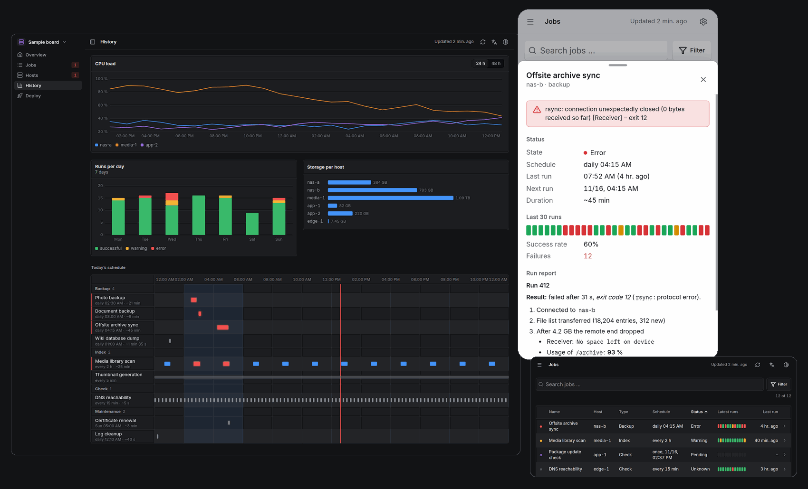
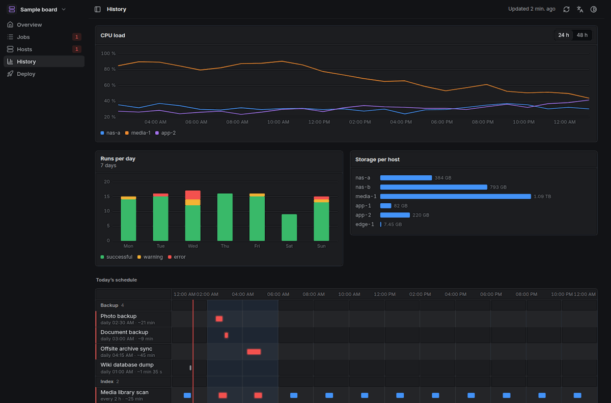
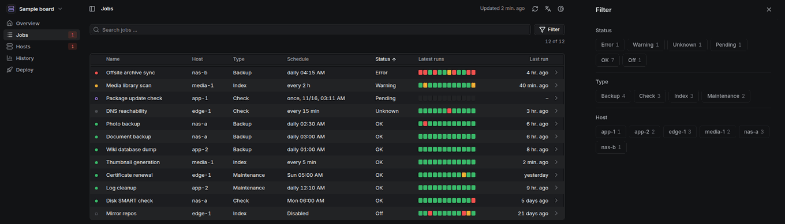
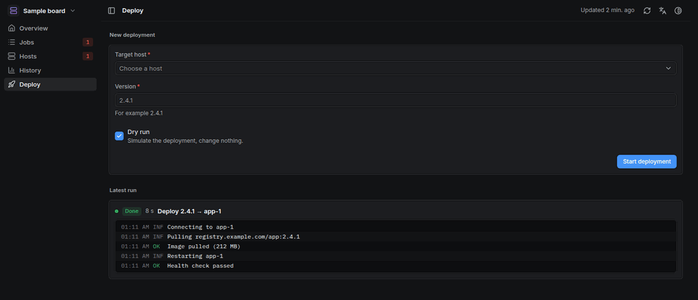
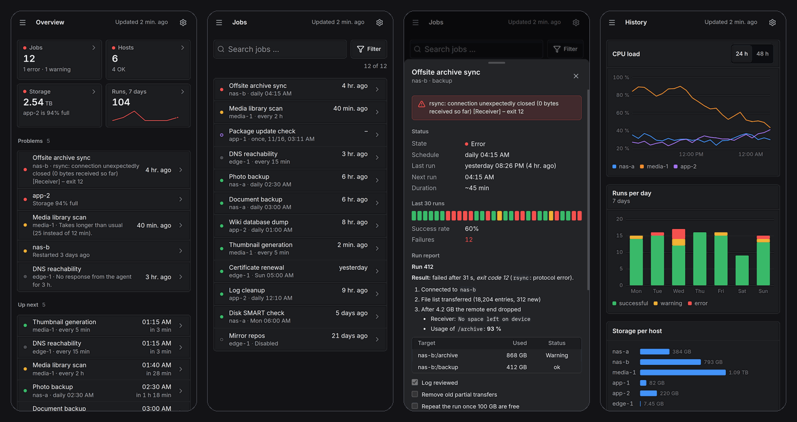
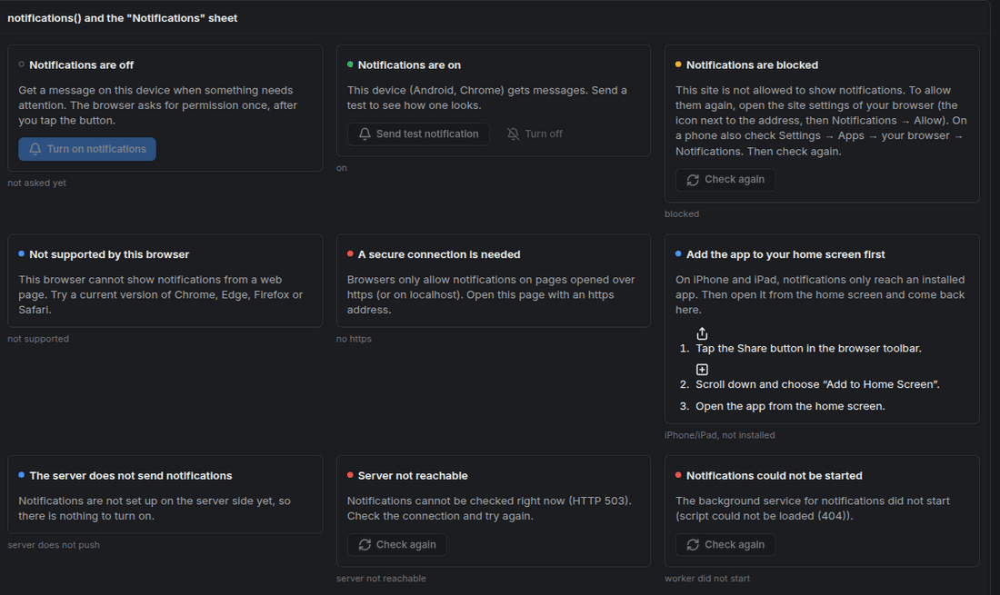

# Tarn

**A UI kit for personal, data-driven software, built so that a coding agent can put an interface up quickly and check it by itself.**

[Live demo](https://r0gner.github.io/tarn/example/) · [Component gallery](https://r0gner.github.io/tarn/gallery/) · [Docs](docs/README.md) · [Build a board (for agents)](docs/building-a-board.md)



> **Building something with Tarn? Read [docs/building-a-board.md](docs/building-a-board.md) first.** It takes an agent from nothing to a board that has
> passed its own checks.

## What Tarn is

Tarn is a set of plain ES modules and CSS for interfaces you use yourself: dashboards first, but also tools that start processes, small trackers and admin
pages. It gives you the parts (a shell with navigation and details, tables, charts, forms, filters, notifications) and one calm, dense look, so that every
board you build looks and behaves the same. There is no build step and no runtime dependency: you copy a fixed version of the kit next to your page. A
coding agent assembles a board from these parts, and the kit's own tools measure the result: overflow, overlap, touch targets, speed, translations.

## What you get

- Adapts to phone, tablet and desktop: sidebar, details (inspector, panel or bottom sheet) and tables change with the width.
- A component library: cards, rows, tables, tiles, banners, menus, toasts, sheets, Markdown reports, every part shown in all states in the gallery.
- Six chart types: line, bar, sparkline, donut, heat row and a timeline for schedules.
- Inputs, validation, filter bar, forms, confirm dialogs and live views of running actions.
- Installable as an app: icons and manifest come from `tools/brand.mjs`.
- Back goes by levels (open layer, then the start view, then out), so the back button of an installed app does what you expect.
- Web push notifications: the browser half (settings sheet, service worker) is built in; your backend sends.
- Light and dark, two densities (compact, and comfortable for touch screens), set by tokens.
- English, German, Spanish and French for the kit's texts; boards add their own.
- No build step, no runtime dependencies, strict CSP (`script-src 'self'; style-src 'self'`).
- Checks that let an agent test its own interface: geometry on five sizes, overlays, response times, snapshots of every view, lint for tokens and texts.
- Several boards with a switcher between them.

## A look inside

**Charts and schedules.** Line, bar and ranking charts with data cards on hover and touch, and a timeline that marks overlapping runs.



**Tables with filters.** Sortable tables that become two-line lists on a phone, a search field, and a filter sheet whose controls follow the data type.



**Forms and actions.** Fields with validation, a form that cannot be sent twice, a confirm step and a live run with log.



**On a phone.** Overview, list, detail as a bottom sheet, charts: the same board at 390 px.



**Notifications.** The settings sheet in every state the browser or the server can be in.



All pictures show the demo board and the gallery with invented data (`tools/docs-images.py` rebuilds them).

## Feeding a board

A board fetches JSON from its own origin. Two ways exist today:

| Way | Fits | You build |
|---|---|---|
| A collector writes a JSON snapshot next to a static server | read-only boards; numbers that change every few minutes | a script that writes one JSON file, a static server (`tools/serve.py` is one), the board folder |
| An active backend | actions, forms with server-side validation, running jobs with a live log, push | a small server for the JSON calls and the posts, serving the board and the kit |

**Planned:** a PromQL data source for an existing Prometheus or VictoriaMetrics. It is not in the code yet.

## Quick start

Needs Node.js 22 or newer, Python 3, and a Chromium-based browser for the checks.

```sh
git clone https://github.com/R0gner/tarn && cd tarn
python3 tools/serve.py --port 18810            # gallery: /gallery/, demo board: /example/
node tools/vendor.mjs --to ../my-board/tarn    # a fixed copy of the kit in a folder of your own board (outside this repository)
node tools/verify.mjs --types                  # a quick check that the tools run (about a second; needs `npx`, skipped offline)
```

Then give your agent [docs/building-a-board.md](docs/building-a-board.md); the `example/` folder is the template to copy.

## Documentation

[What goes on a view](docs/dashboard-guidelines.md) · [Getting started](docs/getting-started.md) · [The shell](docs/shell.md) · [Components](docs/components.md) · [Charts](docs/charts.md) · [Data](docs/data.md) ·
[Inputs, filters, forms and actions](docs/inputs-and-actions.md) · [Notifications](docs/notifications.md) · [Identity, icons, installing](docs/identity.md) ·
[Checks](docs/checks.md) · [Design language and tokens](docs/design.md) · [Visual judge](docs/visual-judge.md) (optional, experimental)

Changing the kit itself: [AGENTS.md](AGENTS.md) and [CHANGELOG.md](CHANGELOG.md).

**Status:** pre-1.0, not announced yet. Pull requests are not accepted for now; issues are welcome: see [CONTRIBUTING.md](CONTRIBUTING.md), the [issue tracker](https://github.com/R0gner/tarn/issues) and the [releases](https://github.com/R0gner/tarn/releases).

## Licence

[MIT](LICENSE), copyright (c) 2026 R0gner. The bundled Lucide icons (ISC), Inter and IBM Plex Mono (SIL Open Font License 1.1) keep their own licences; see
[NOTICE](NOTICE).
